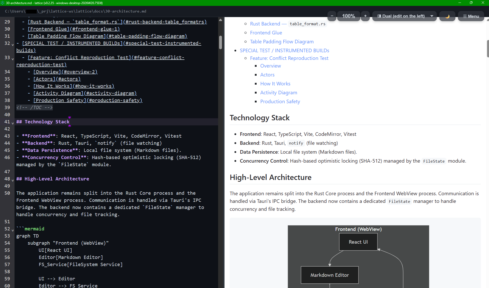
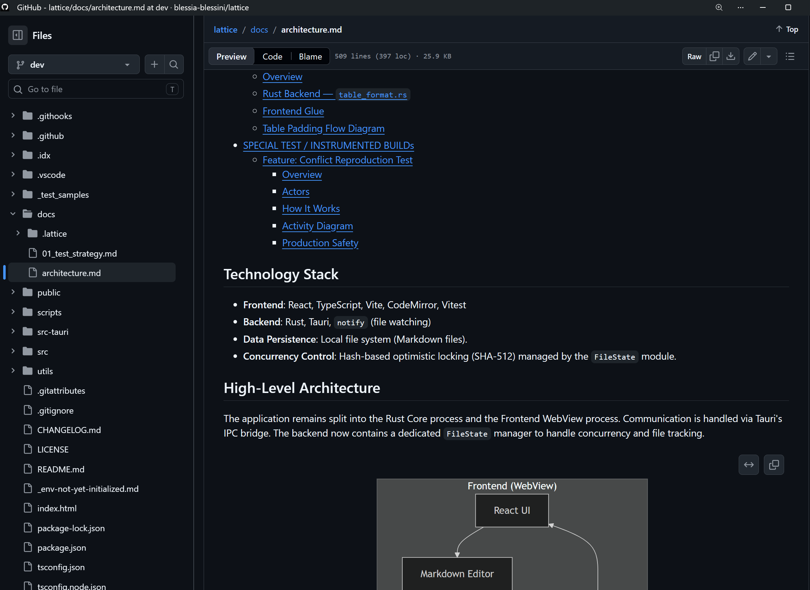

# _Lattice_ &emsp;&emsp;&emsp; [](https://github.com/blessia-blessini/lattice/actions/workflows/buildAndTest.yml) [](#licensing) 

**Lattice** is an open-source, local-first Markdown editor and viewer, designed to bridge the gap between Personal Knowledge Management (PKM), and Systems Engineering.

## WHAT IS `Lattice` and WHY it exists


Lattice is a local-first, multiplatform, private Markdown Editor and Viewer.  
It is designed for productivity (Desktop work): Windows, MacOS and Linux.  
Lattice works on Android and is designed to work on with iOS "one day".  

Lattice is transparent - being **open-source is a core part of the value of the product**. 
It guarantees that it's user will not be "kept a hostage".

By using MD format, Lattice:
 - strikes the right balance between form and content
 - is very good for version control. 

Thus, it is very well-fit for projects adopting plain text as major documentation format for any project.


Being Markdown based, enables users of _Lattice_ to have:  
&ensp;&ensp;  ⇒ **DOCUMENTS AS CODE**  
  &ensp;&ensp;&ensp;&ensp;&ensp;&ensp;&ensp;&ensp;&ensp;&ensp;&ensp;&ensp;OR  
&ensp;&ensp;  ⇒ **Documents in plain-text**.

  Lattice strikes the right balance between _form_ and _content_. That is, one can still give **priority** of _content_ over _form_ when creating documents, while still keeping the expressiveness of the needed _form quality_ at very high aesthetic and comprehension level.   
  Lattice enables the _de-facto default interface markdown format_ between HUMANS and AI be directly managed as a _simple (set of) file(s)_ on a _local_ desktop computer or mobile phone. 
  
The plain-text format is efficiently versioned and `diff`ed by all code-versioning systems, which makes it ideal for mid- to strong- **change-controlled environment**(s) like engineering.  

The lack of native graphycal support is compensated by:
   - picture copy/paste with clear storage placement
   - mermaid for UML and other structured graphucs.

   
#### SHORT DESCRIPTION

 - Target Users are Data-Scientists, Developers and Tech-savvy people that want to make "documentation as code". The format suggested is Markdown as close as possible to GitGub.

   Markdown (*.md) files created with lattice look very much like (are rendered in preview mode like) the md files on GitHub. Here is a screenshot of how the lattice architecture document looks like (in lattice the preview/print theame is always `light` by design (and cannot be changed intentionally)):
    
, and here is how it looks on GitHub with a popular browser (with GitHub in `dark` theme mode):
    

 - **Easy to print-out** as pdf

#### IN TECHNICAL TERMS

 - **a recent set of CodeMirror features** - see https://codemirror.net/ 
 - **Split editor / preview** — CodeMirror 6 editor with live Markdown preview side-by-side
 - **Paste pictures** - paste directly pictures like screenshots in the document (stores the picture in a folder-name **derived from** the file name )
 - **Multi-window** — open multiple files in independent windows simultaneously
 - **Conflict detection** — hash-based optimistic locking prevents silent data loss when a file is modified externally
 - **Table of Contents** — auto-generate and refresh a linked heading list with `Ctrl/Cmd+Shift+T`
 - **Table formatting** — align pipe-table columns with `Ctrl/Cmd+Shift+L`
 - **`==highlight==` marks** — `==text==` syntax rendered with a highlighted background
 - **Daily notes** — one click on 🗒 (or the menu) opens today's note, e.g. `DLN-2026-08-04-Tue.md`, creating it with a title if needed; folder, prefix and an optional calendar-week title (`2026 CW32 Tue`) are configurable
 - **Mermaid diagrams** — fenced ` ```mermaid ``` ` blocks rendered inline
 - **Dark / light themes** — editor and preview themes are independent of each other and the OS
 - **Cross-platform** — Windows, macOS (universal), Linux, Android, iOS (the latter not delivered yet)

---

## DOCUMENTATION

- [Requirements](docs/10-System-Requirements.md) — in progress not all formally extracted yet
- [Architecture](docs/30-architecture.md) — technology stack, data flow, CI pipeline, feature design
- [Test Strategy](docs/60-test-strategy.md) — test pipeline, coverage, linting

---

## INSTALLATION

### FOR USERS

**Windows** — install from the Microsoft Store (recommended: signed package, automatic updates):

<a href="https://get.microsoft.com/installer/download/9pm3gb09941t?referrer=appbadge" target="_self"><picture><source media="(prefers-color-scheme: dark)" srcset="https://get.microsoft.com/images/en-us%20light.svg"></picture></a>

**All platforms** (Windows, macOS, Linux, Android) — download the latest stable release for your platform from our **[Releases Page](https://github.com/blessia-blessini/lattice/releases)**.

### FOR DEVELOPERS
Lattice is built with **Tauri v2**, **Rust**, and **React**.
#### GETTING STARTED / SETUP FOR DEVELOPMENT (EASIEST WAY TO)

1.  Clone the repository.
2.  Initialize the environment:
    *   **Windows**    : `.\scripts\setup_env.ps1`
    *   **macOS/Linux**: `./scripts/setup_env.sh`
      
#### PREREQUISITES (WHAT WILL BE INSTALLED BY THE SCRIPT ABOVE)
*   **Rust**: [Install Rust](https://www.rust-lang.org/tools/install)
*   **Node.js & npm**: [Install Node.js](https://nodejs.org/)

> Note: installation can be done with, and is documented in `.\scripts\setup_env.ps1` and `.\scripts\setup_env.sh` for Windows and Linux/MacOS respectively.

#### ENVIRONMENT CONFIGURATION (CRITICAL)

The build system requires the `LATTICEBUILD_NO` environment variable to be set. Without this, even `rust-analyzer` (which often runs automatically depending on installed extensions in VSCode) might report errors or builds may fail (though debug builds default to a safe fallback).

**For VS Code Users:**
We recommend adding this to your `.vscode/settings.json` or `.code-workspace` file:

```json
{
    "rust-analyzer.cargo.extraEnv": {
        "LATTICEBUILD_NO": "DevBuild"
    }
}
```

**For Command Line:**
*   **PowerShell**: `$env:LATTICEBUILD_NO="DevBuild"; npm run tauri dev # (| build )`
*   **Bash**: `export LATTICEBUILD_NO="DevBuild"; npm run tauri dev # (| build )`

#### COMMANDLINE FOR DEVELOPERS

We provide cross-platform scripts to help you build andrun the app, and to automatically handle environment variables (like `LATTICEBUILD_NO`) and standardize the build pipeline. You are encouraged to look into the scripts before you run them

| Description                                                               | macOS / Linux (Bash)         | Windows (PowerShell)          |
| :------------------------------------------------------------------------ | :--------------------------- | :---------------------------- |
| **1. Setup environment** (Install Rust, Node, NPM deps, init Android)     | `./scripts/setup_env.sh`     | `.\scripts\setup_env.ps1`     |
| **2. Start the app** in _development mode_ with hot-reload                | `./scripts/build-dev.sh`     | `.\scripts\build-dev.ps1`     |
| **3. Run the complete test suite** (Backend, Frontend, Coverage, Linting) | `./scripts/build-test.sh`    | `.\scripts\build-test.ps1`    |
| **4. Build a production release** for the respective OS                   | `./scripts/build-release.sh` | `.\scripts\build-release.ps1` |

#### DEVELOPMENT COMMANDS ALTERNATIVE

| Command               | Description                                           |
| :-------------------- | :---------------------------------------------------- |
| `npm run tauri dev`   | Start the app in development mode with hot-reloading. |
| `npm run tauri build` | Build a production release for your OS.               |

## LICENSING

Lattice is dual-licensed. Its copyright holder, Blessia Blessini, offers it under your choice of:

1. **The GNU Affero General Public License, version 3 or (at your option) any later version**
   (AGPL-3.0-or-later, see [LICENSE](LICENSE)) — free of charge, for any purpose: personal,
   open-source **and commercial** use, in an organisation of any size. In return, the AGPL's
   conditions apply. In short: if you distribute Lattice or a modified version of it, you pass on
   the same freedoms and make the corresponding source code available; if you modify Lattice and
   let others use your version over a network, you offer them its source code. The [LICENSE](LICENSE)
   text is binding; this summary is not.

2. **A commercial licence** — for anyone who wants to use, modify, embed or distribute Lattice
   without the AGPL's conditions, for example inside a proprietary product.
   Contact `blessia AT blessini.com`.

Lattice also contains third-party components under their own licences; they are listed with their
copyright notices and licence texts in [THIRD-PARTY-NOTICES.md](THIRD-PARTY-NOTICES.md).

### WHEN WE ASK YOU TO CHOOSE THE COMMERCIAL LICENCE

Everything below is allowed under the AGPL. Nevertheless, the commercial licence funds Lattice's
development, so we ask organisations to take one when Lattice is:

- integrated (embedded) into the organisation's automated workflows or production pipelines,
- distributed as part of a commercial product or service, or
- used by more than *25 people* within the same organisation.

Individual employees who use Lattice for their own work tasks and editing are not asked to.

This is a request, not a condition: it adds no restriction to the AGPL, and the AGPL remains
available to everyone. Contact `blessia AT blessini.com`.

### YOUR DOCUMENTS

The AGPL covers Lattice itself, not the documents you write with it.

**Additional permission under section 7 of the AGPL — exported documents.** When Lattice exports a
document (for example to HTML or PDF), it may copy parts of its own stylesheets or other code into
the exported file. As a special exception, the copyright holder gives you permission to use, copy,
modify and distribute those copied parts, as part of the exported document, under terms of your
choice; the AGPL's conditions do not apply to the exported document because of them. This exception
does not apply to Lattice itself or to any modified version of Lattice. If you modify Lattice, you
may extend this exception to your version, but you are not obliged to do so; if you do not wish to,
delete this exception statement from your version.

Third-party parts that an export may contain (such as KaTeX's stylesheet and fonts) remain under
their own licences, listed in [THIRD-PARTY-NOTICES.md](THIRD-PARTY-NOTICES.md).

### CONTRIBUTING

Because Lattice is offered under two licences, contributions can only be accepted under terms that
allow them to be offered under both. Please open an issue before preparing a pull request.
